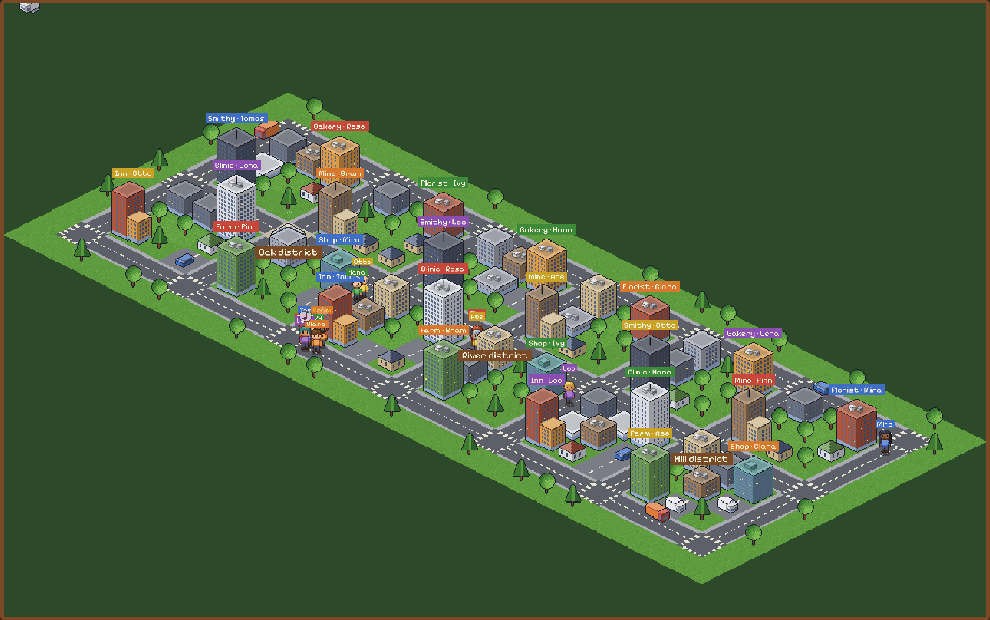
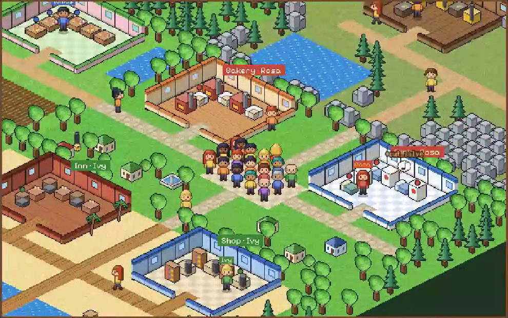

# World Seeds

[English](README.md) | [中文](README.zh-CN.md)


World Seeds is an **environment for networks of agents**: task distribution, information sharing, many
agents working one problem together, division of labour. It is a simulator: it moves messages, runs the
task market and the shared store, charges every action and keeps score. How agents should cooperate is
not written into it; that is what gets studied and, later, trained.

The repository has two halves, kept apart on purpose:

| | |
|---|---|
| `worldseeds/` | **the environment**: the network (`worldseeds/net`), its task providers, presets and held-out tasks, the CodeWorld world and its town, the HTTP server, town replays |
| `netagents/` | **the agents**: they reach the environment only through its public interface (`step`, `ops`, `observe`, `public`), in the same process or over HTTP |

## The environment: one network, pluggable tasks

[docs/network.md](docs/network.md). The network layer handles messages, the notice board, a task market
over a dependency graph, a versioned shared store, credits, reputation, topology, latency, outages,
budgets and deadlines. It knows nothing about the work. The work comes from a *task provider*: `reset`,
`roles`, `ops`, `apply`, `tasks`, `verify` and optionally `tick`. Four come with it:

- **codeworld**: functions with hidden laws and projects that need several of them; the synthetic twin
  (and, with `theme="town"`, the town you can watch);
- **math**: lemma graphs checked by SymPy; load your own problems from JSON;
- **website**: a versioned workspace, tests in a sandbox, hidden acceptance tests, a client to ask; load
  your own tasks from a directory;
- **molecule**: RDKit edits, noisy assays against a hidden structure-activity function; your own targets
  or oracle.

Presets give three difficulties per provider and three variants with the same compute (`team`, `solo`,
`nonet`); held-out tasks in `tasks/heldout/` were never seen by any scripted team.

```bash
python scripts/run_net.py --list-presets
python scripts/run_net.py --preset math/hard --serve 8090          # serve the environment over HTTP
```

## The agents

[netagents/](netagents/__init__.py): clients (`LocalEnv`, `RemoteEnv`), tools generated from the op specs
(OpenAI tool format, Agents SDK), an LLM team (every agent concurrently, any OpenAI-compatible server,
e.g. Qwen3-8B on vLLM), a random policy for fuzzing, and reference teams written for the built-in tasks.

```bash
python -m netagents.run --preset math/hard --variant solo --policy scripted --seeds 0 1 2
WS_BASE_URL=http://localhost:8000/v1 WS_MODEL=qwen3-8b python -m netagents.run --preset website/medium --policy llm
python -m netagents.run --remote http://127.0.0.1:8090 --policy llm      # against a served environment
python -m netagents.baselines --seeds 10                                # reference teams on every preset
```

Published agent designs run on the same environment with matched compute ([docs/testset.md](docs/testset.md)): ReAct,
Reflexion, the single / independent / centralized / decentralized / hybrid architectures of Kim et al. (2026),
multiagent debate, the LbMAS blackboard system, Mixture-of-Agents, and AutoGen, Magentic-One and CAMEL teams run in
their own frameworks. They run on two tracks: a compatibility track in the papers' own settings, where published
findings are reproduced first (identical agents, no deadline, messages passed by the framework), and a network track
for what this environment adds (role-split tools, topologies, latency, costs; messages travel through the network).
Network-track suites cover development, testing, held-out tasks, scaling, topology and robustness:

```bash
python -m netagents.evaluate --suite compat --designs sas independent centralized decentralized hybrid
python -m netagents.evaluate --suite dev --designs all
ACCOUNT=def-yourpi bash slurm/run_all.sh                                   # every experiment on Nibi (docs/testset.md)
```

## Watching a run: SeedVille Workshops

Any run on the CodeWorld provider in the town theme can be watched in the browser: agents walk to
workshops to study machines, write rules down at the library, send letters through the post office, pin
notes on the board and deliver orders. The page shows what the environment recorded
(`worldseeds/net/replay.py`), whoever the agents were.

```bash
python -m netagents.replays                      # reference teams -> web/replays/codeworld.json
python -m netagents.replays --llm                # LLM teams      -> web/replays/llm.json
python -m http.server -d web 8000                # open http://localhost:8000
```

| | |
|---|---|
|  |  |

## Running on Nibi (Compute Canada / Alliance)

```bash
git clone https://github.com/bochendong/EnviorementalAgent.git ~/EnviorementalAgent
cd ~/EnviorementalAgent && bash slurm/setup_nibi.sh        # venvs in $SCRATCH, Qwen3-8B, tests
# set --account in slurm/net_llm.sh, then:
sbatch slurm/net_llm.sh                                    # LLM teams on the presets (PRESETS, VARIANTS, SEEDS)
```

## Repository layout

```
worldseeds/net/         the network environment: core.py (provider interface), env.py, presets.py,
                        providers/ (codeworld, math, website, molecule), server.py, replay.py
worldseeds/codeworld/   the CodeWorld world and its town: world.py, townmap.py, recipes.py, events.py,
                        goals.py, economy.py
netagents/              the agents (clients, tools, LLM team, reference teams, run, baselines, replays)
tasks/heldout/          held-out tasks (math, website, molecule)
web/                    the town replay page (codeworld.html), its art (web/tools: kairoart.py, make_people.py)
scripts/run_net.py      serve the environment
slurm/                  Nibi: setup_nibi.sh, run_all.sh (every experiment), net_eval.sh, net_fidelity.sh
docs/                   network.md, testset.md, codeworld.md
```

The agent code of earlier experiments (World Seeds memory agents, hives, CodeWorld developers, the LLM
tutorial and ladder) the SeedVille farming town and the original World Seeds dungeon world were removed; it is in the git history before commit `290b93f`.
