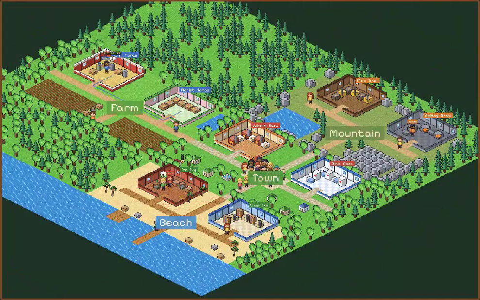

# World Seeds

[English](README.md) | [中文](README.zh-CN.md)



World Seeds 是一个**智能体网络的环境**，研究的对象包括任务分发、信息共享、多个智能体一起攻克一道题，以及分工协作。它是模拟器，负责的事情是：传递消息，运行任务市场和共享库，给每个动作计费，记分。智能体该怎么合作，环境里不写，这正是要研究、之后要训练的东西。

仓库分成两半，刻意分开：

| | |
|---|---|
| `worldseeds/` | **环境**：网络（`worldseeds/net`）、任务提供者、难度配置和留出任务、CodeWorld 世界和它的小镇、HTTP 服务、小镇回放 |
| `netagents/` | **智能体**：只通过环境的公开接口（`step`、`ops`、`observe`、`public`）访问环境，同一进程或通过 HTTP 都行 |

## 环境：一个网络，可插拔的任务

详见 [docs/network.md](docs/network.md)（含中文）。

网络层负责：消息、公告板、依赖图上的任务市场、版本化共享库、额度、信誉、拓扑、延迟、掉线、预算和截止时间。它不关心具体做什么工作。

工作由"任务提供者"决定，接口是 `reset`、`roles`、`ops`、`apply`、`tasks`、`verify`，可选 `tick`。内置四个：
- **codeworld**：带隐藏规律的函数，加上需要组合多个函数的项目，是合成的对照任务。用 `theme="town"` 就是可以观看的小镇。
- **math**：引理依赖图，用 SymPy 检验，可以从 JSON 载入自己的题目。
- **website**：版本化工作区、沙箱测试、隐藏验收测试、可以问客户，可以从目录载入自己的任务。
- **molecule**：RDKit 结构修改，带噪声的实验，隐藏的构效关系，可以换成自己的目标或模型。

难度配置：每个任务有三档难度，每档有三种算力相同的对比方式（`team`、`solo`、`nonet`）。`tasks/heldout/` 里的留出任务，脚本团队从没见过。

```bash
python scripts/run_net.py --list-presets
python scripts/run_net.py --preset math/hard --serve 8090          # 通过 HTTP 提供环境服务
```

## 智能体

[netagents/](netagents/__init__.py) 里有：
- 客户端：`LocalEnv` 和 `RemoteEnv`；
- 根据操作说明自动生成的工具（OpenAI 工具格式、Agents SDK）；
- LLM 团队：所有智能体并发运行，可接任何兼容 OpenAI 接口的服务，比如 vLLM 上的 Qwen3-8B；
- 用于健壮性测试的随机策略；
- 为内置任务写的参考团队。

```bash
python -m netagents.run --preset math/hard --variant solo --policy scripted --seeds 0 1 2
WS_BASE_URL=http://localhost:8000/v1 WS_MODEL=qwen3-8b python -m netagents.run --preset website/medium --policy llm
python -m netagents.run --remote http://127.0.0.1:8090 --policy llm      # 连到单独运行的环境
python -m netagents.baselines --seeds 10                                # 参考团队跑所有配置
```

## 观看运行：SeedVille Workshops

CodeWorld 提供者用小镇主题时，任何一次运行都能在浏览器里看。智能体会：
- 走到工坊研究机器；
- 在图书馆记下规律；
- 通过邮局寄信；
- 在公告板贴便条；
- 交付订单。

页面展示的就是环境记录下的内容（`worldseeds/net/replay.py`），不管智能体是谁。

```bash
python -m netagents.replays                      # 参考团队 -> web/replays/codeworld.json
python -m netagents.replays --llm                # LLM 团队  -> web/replays/llm.json
python -m http.server -d web 8000                # 打开 http://localhost:8000
```

## 在 Nibi 上运行

```bash
git clone https://github.com/bochendong/EnviorementalAgent.git ~/EnviorementalAgent
cd ~/EnviorementalAgent && bash slurm/setup_nibi.sh        # 在 $SCRATCH 建环境、下载 Qwen3-8B、跑测试
# 先在 slurm/net_llm.sh 里填好 --account，再：
sbatch slurm/net_llm.sh                                    # LLM 团队跑各个配置（可设 PRESETS、VARIANTS、SEEDS）
```

## 目录

```
worldseeds/net/         网络环境：core.py（提供者接口）、env.py、presets.py、providers/、server.py、replay.py
worldseeds/codeworld/   CodeWorld 世界和小镇：world.py、townmap.py、recipes.py、events.py、goals.py、economy.py
netagents/              智能体（客户端、工具、LLM 团队、参考团队、运行、基线、回放）
tasks/heldout/          留出任务（数学、网站、分子）
web/                    小镇回放页面（codeworld.html）和它的美术（web/tools：kairoart.py、make_people.py）
scripts/run_net.py      提供环境服务
slurm/                  Nibi：setup_nibi.sh、start_vllm.sh、net_llm.sh
docs/                   network.md、codeworld.md
```

早期实验的 agent 代码、SeedVille 农场小镇和最早的 World Seeds 地牢世界已经删除，agent 代码包括 World Seeds 的记忆智能体、蜂群、CodeWorld 开发者、LLM 教程和阶梯。这些都还在 git 历史里，在提交 `290b93f` 之前。
